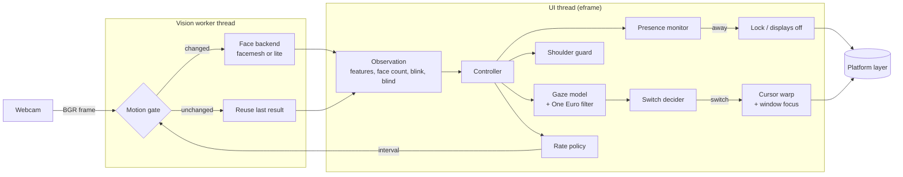
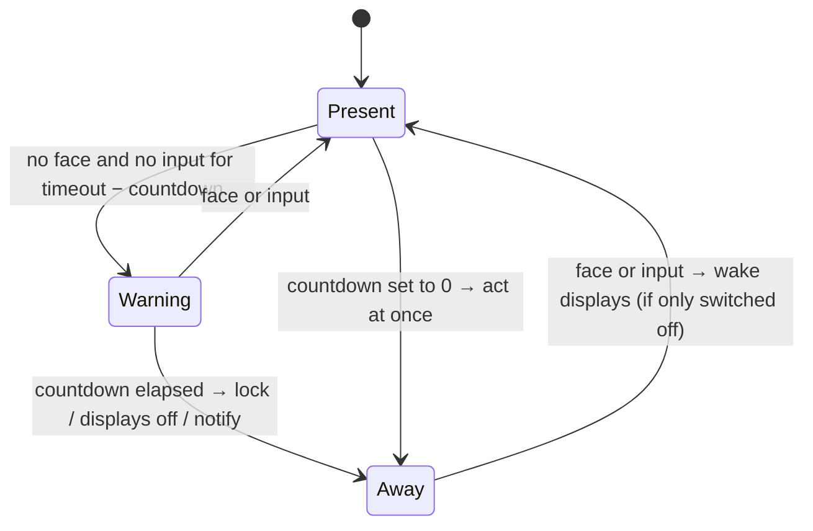

# Architecture

Eye Tracker is a small Rust tray application (egui and eframe) with a vision thread. This document describes how a
camera frame becomes a cursor jump, what runs on which thread, and why the code is split the way it
is.

## The pipeline



1. **Capture.** `vision/camera.rs` opens the camera through nokhwa, which uses the platform's native
   API (Media Foundation, AVFoundation, V4L2), at 640×480. It asks for MJPG where that helps (not on
   AVFoundation, which has none) and only drops stale frames when the loop has been idle longer than
   a frame period. Besides cameras, the same module plays still images and folders of image frames,
   for tests and demos; there is no video-file input.
2. **Motion gate.** `vision/motion.rs` compares a 32×24 grey thumbnail of the frame, plus a
   thumbnail of the eye band, with the last analysed frame. If nothing moved, the previous result is
   reused and no neural network runs. A blink is never reused, and neither is a result the face
   backend has not settled on (see below): the picture stops changing as soon as the user sits
   still, and the gate would otherwise repeat biased features. The gate is off while the camera
   preview is open. The same thumbnail flags *blind* frames (lens covered, shutter closed, dark
   room) so they are treated as "cannot tell" rather than "nobody here".
3. **Face backend.** `vision/backends/`:
   - **facemesh** (default) runs MediaPipe's face-landmark network (478 points including both
     irises) with [tract](https://github.com/sonos/tract) (a pure-Rust inference engine) and fits the
     canonical face mesh with a Levenberg-Marquardt PnP solver (`vision/backends/pnp.rs`) for head
     pose. It tracks the face region from frame to frame. After a posture shift it runs the network
     again on the region the landmarks ask for (two to four inferences for that one frame), so the
     features are right on the first frame; until the region has caught up, the result counts as
     not settled. YuNet (also run by tract; `vision/backends/yunet.rs`) finds the face when tracking is lost, also rotated by ±45° for a strongly
     tilted head. Every 1.5 s (and 0.5 s after a face was found) one small YuNet detection checks
     whether a clearly larger or more central face is in view, so a poster or a colleague picked up
     while the user was away does not keep control once the user is back. Features: yaw, pitch,
     roll, head position, and the iris position inside each eye.
   - **lite** uses only YuNet's five landmarks (eyes, nose, mouth corners): head orientation
     without eye direction, for the lowest CPU use.

   The MediaPipe *runtime* is intentionally not used. Its native library contains a usage-logging
   uploader, and this app never touches the network (see [privacy.md](privacy.md)).
4. **Gaze model.** `gaze/model.rs` maps the feature vector to a point on the virtual desktop with
   ridge regression on standardised features. Nonlinear terms (squares, pairwise products, cubes)
   are built only from the gaze-direction features (yaw, pitch, iris), never from head position or
   roll, so leaning back or sitting lower does not bend the fit. Degree and regularisation are
   chosen by leave-one-point-out cross-validation on the calibration data. The same fit yields a
   linear estimate of the combined gaze direction (head plus eyes); when it lies more than 0.2 × the
   nearest monitor's diagonal outside every monitor, the user is looking away (phone, desk), which
   suppresses switching. Monitors of different pixel density (a 4K panel next to a 1080p one) make
   that single linear estimate overshoot on the coarser monitor, so the calibration also records
   where the estimate places each monitor, and gaze near that place counts as on screen too. Models
   saved by older versions use a per-feature range test instead until they are recalibrated or
   refined by adaptive learning.
5. **Smoothing.** A One Euro filter (`gaze/filters.rs`) removes webcam jitter while keeping
   deliberate head turns fast.
6. **Switch decision.** `engine/decision.rs` turns the smoothed gaze into at most one switch; see
   [The switching rules](#the-switching-rules).
7. **Action.** The controller remembers the cursor position and focused window of the monitor being
   left, warps the cursor to the target monitor and gives keyboard focus to the last window used
   there. No synthetic clicks are ever sent.

## The switching rules

A switch fires only when all of these hold:

| Rule | Default | Why |
|---|---|---|
| **Dwell.** The gaze has favoured the other monitor continuously | 300 ms | Quick glances do nothing. |
| **Hysteresis.** The gaze is clearly nearer the other monitor than the current one | 6 % of the monitor's shorter side | Jitter at the bezel cannot flip-flop. The margin also holds below and above the seam, where the keyboard usually is. |
| **Not looking away.** The combined gaze-direction estimate is on or near a monitor, and so is the smoothed gaze point | within 20 % and 35 % of the monitor's diagonal | Looking at a phone or the desk is ignored. |
| **Mouse grace.** No manual mouse movement recently | 1.5 s | The mouse always wins. |
| **Typing grace.** No keystroke recently | 2 s | Focus never moves in the middle of a sentence. |
| **Reading grace.** If you typed while looking at the other monitor (copying from it) | 6 s | Pausing to read the source document does not steal focus from the editor. |
| **Cooldown.** Time since the previous switch | 600 ms | No ping-pong. |

Typing is detected without a keyboard hook. The OS idle timer resets on any input; if it resets
while the cursor did not move, it was a key press (or a click or scroll). On macOS the idle time of
key events can be read directly. No key contents are ever observed.

## Presence and privacy states



The countdown is part of the timeout: with the defaults it starts after 35 s without face or input,
and the action runs at 45 s. Seeing the user cancels it, and so does keyboard or mouse input while
`presence.require_input_idle` is on (Wayland outside GNOME reports no input, so there only the
camera can). With a countdown of 0 the action runs without warning. Until the first-run setup is
finished, the lock and display-off actions only notify.

A frame that cannot be judged (camera off, privacy mode, calibration) freezes the timers instead of
counting as absence. A blind frame (lens covered, dark room) freezes them only when the blindness
began while the user was demonstrably there (face seen or input within 3 s), and then for at most
5 minutes without input; blindness that begins after the user left counts as absence.

Every detected face counts as the user. The shoulder guard (`engine/guard.rs`) never decides
presence: it compares face boxes and cannot recognise faces, and a wrong "that is not the user"
would lock out someone sitting at their own desk. It only decides whether its reaction (curtain,
notification, lock) is still needed. It triggers after a second face has been in view for 2 s,
follows whose face is the user's by continuity of the face box (not by size, so a colleague leaning
in closer never becomes the user), keeps the curtain up while only the other person's face is left,
and clears once the user's face is the one in view again or the keyboard or mouse is used. While it
judges the user gone, two faces in view trigger it again, so a judgement that was wrong never
silences it.

The controller derives one tracking state from its flags, in this priority order:

`Privacy > Locked > Calibrating > Paused > Yielded > Away > Camera error > Needs calibration > Tracking`

The camera is released in Privacy, Locked, Paused and Yielded, so the webcam light is off. Privacy
mode is remembered across restarts (`privacy.remember_privacy_mode`), so the camera stays off until
the user turns it off. *Needs calibration* applies only where a calibration would change something:
with two or more monitors and switching turned on.

## Frame rate and CPU

The camera is never read faster than needed. `engine/scheduler.rs` picks the analysis rate from the
situation:

| Situation | Eco | Balanced | Responsive |
|---|---:|---:|---:|
| A switch is pending or the gaze is moving | 8 fps | 12 fps | 20 fps |
| Idle, looking at the current monitor | 2 fps | 4 fps | 8 fps |
| Typing | 1 fps | 2 fps | 4 fps |
| No face | 1 fps | 2 fps | 3 fps |
| Away | 0.5 fps | 1 fps | 1 fps |
| Calibrating or preview open | 15 fps | 24 fps | 30 fps |

Most idle frames are then skipped by the motion gate, so a typical session analyses only a few
frames per second. `eye-tracker bench` measures the cost on your machine.

## Threads

| Thread | Owns | Talks to the rest via |
|---|---|---|
| UI thread (eframe) | Controller, UI, gaze model, decisions, platform calls | Drains the workers' channels in `update()` |
| Vision worker | Camera, motion gate, face backend | `crossbeam-channel` events (observations, stats, preview frames) |
| Hotkey thread (Windows, X11) | `RegisterHotKey` message loop / `XGrabKey` event loop | Channel to the UI thread |
| Pane worker | Pane providers (the terminals' own command-line tools) | Request channel in, event channel out |

The face backend is created, used and closed on the worker thread. The worker's setters
(`set_interval`, `set_active`, …) are thread-safe and wake the loop. Workers wake the UI thread with
`ctx.request_repaint()`; there is no async runtime in the app.

## Calibration

`gaze/calibration.rs` shows nine dots per monitor in a serpentine order. For each dot it waits
0.8 s for the eyes and head to settle, then collects samples for 1 s, skipping blinks and
unusable frames. A dot with too few samples is retried once and then skipped. The result is graded
by leave-one-point-out cross-validation: each dot is predicted by a model that never saw it.

The calibration window (`ui/calibration_window.rs`) pauses the dots while no face has been seen for
1.5 s. Walk-away detection and the shoulder guard are suspended while it is open, so it closes
itself after 60 s without a face, or after 2 minutes without a key press while it waits for one.

Calibrations are stored per monitor layout, backend and camera (`gaze/store.rs`), so moving a
laptop between two docks switches between profiles instead of forcing a recalibration. Only numbers
are stored: feature vectors and target points, never images.

While you work, the app learns from natural mouse use: when you move the mouse to a spot and stop,
you are almost always looking at it. Those samples refine the model with a lower weight. Samples
that disagree with the model by more than a monitor are rejected rather than learned, and a drift
monitor suggests recalibrating when accuracy drops. At most `learning.max_samples` learned samples
are kept per profile; lowering the limit trims and refits every stored profile when it is next
used. On Wayland nothing is learned, because the pointer position cannot be read there.

## Coordinates

All screen coordinates are native pixels on Windows and Linux/X11, and Cocoa points on macOS, which
is what Quartz and the Accessibility API use. The app is per-monitor DPI aware on Windows and
tells winit not to scale on X11 (`WINIT_X11_SCALE_FACTOR=1`). No conversion happens anywhere.

## Code map

```text
crates/eye-tracker/src/
  types.rs            shared value types (Rect, Monitor, Observation, TrackingState)
  config.rs           typed settings with validation and forgiving loading
  paths.rs            config, data and log directories
  logging_setup.rs    the rotating log file
  trace.rs            the optional numeric trace
  vision/             camera, motion gate, worker thread, face backends (and the models' loaders)
  gaze/               gaze model, filters, calibration, calibration store, implicit learning
  engine/             decision, reading rule, presence, guard, scheduler, input tracking, controller
  panes/              split-pane focus (experimental): providers, worker thread, decision
  platform/           Windows / macOS / Linux integration, autostart, global hotkeys
  ui/                 tray, settings, calibration window, overlays, wizard, update window
  update/             the opt-in update check and installer; winhttp.rs is the only network file
  app.rs, cli.rs      application wiring and command line
  ipc.rs              single instance and `eye-tracker ctl`
  diagnostics.rs      `doctor` and `bench`
  testing/            shared test helpers (compiled for tests only)
  bin/                the console binary `eye-tracker` and the windowed `eye-tracker-gui`
crates/eye-tracker/models/   the model files (embedded with include_bytes!), NOTICE.md, licenses/
crates/xtask/                `cargo xtask`: developer tools (privacy gate, models, icons, docs, site)
```

`gaze/` and `engine/` (except `controller.rs`) touch neither the camera, the UI nor the operating
system, and take the current time as an argument, so the logic that decides when to switch or lock
is tested deterministically. The same holds for `panes/decider.rs`; the pane providers run the
terminals' own command-line tools on the pane worker's thread ([split-pane focus](panes.md)).

## Conventions

- **One module, one file.** Every area has the module layout above, and the module's public
  functions, types and constants keep their names between the code, the docs and the tests.
- **Tests sit next to the module.** The tests of `src/foo.rs` live in `src/foo_tests.rs`, declared
  at the bottom of `foo.rs` with `#[cfg(test)] #[path = "foo_tests.rs"] mod tests;`, so they can use
  private items. A header comment in the tests file lists what is deliberately not tested and why
  (a test that needs a real camera or a face photo returns early without
  `EYE_TRACKER_TEST_FACE`). Shared fixtures are in `src/testing/`.
- **Events and `tick(now)`, not callbacks and timers.** A component collects what it wants to
  announce in a `Vec<Event>` (an enum per component) that the method returns or that
  `drain_events()` hands over; the owner (controller, app) dispatches. Nothing stores callbacks.
  A component with a deadline keeps its own due time and has a `tick(now: f64)` method that the app
  loop calls at a fixed cadence. Workers are `std::thread`s with a request channel in and an event
  channel out, joined on `stop()` or on drop.
- **The UI seam.** A UI module never holds the controller. It exposes
  `show(ctx: &egui::Context, inputs: &XInputs) -> Vec<XAction>`: one `XInputs` struct of the plain
  values it displays and one `XAction` enum of what the user asked for. `app.rs` feeds the inputs
  from controller state and maps the actions to controller calls.
- **Overlays are immediate viewports.** Calibration, the gaze dot, the privacy curtain and the
  countdown toast are `ctx.show_viewport_immediate` windows built from a monitor's rectangle:
  borderless, always on top, positioned at the monitor's origin and sized to it. The dot and the toast
  are transparent and click-through. Dialogs (settings, wizard, about, update, preview) are viewports
  with decorations. Monitors come from `platform::monitors()`, primary first, and the controller
  polls them once a second to notice a monitor being plugged in or out.
- **Degrade, never crash.** Platform calls return `bool` or `Option`; a failure is logged and the
  app carries on. `unwrap()` and `expect()` appear only in tests and on invariants the code itself
  guarantees.
- **Settings and data files are compatible.** Names, locations, JSON keys, versions and migrations
  stay as they were, so an upgrade keeps settings and calibrations.
- **Privacy is enforced mechanically.** No networking code outside `update/winhttp.rs`, and no frame
  is ever written to disk: `cargo xtask check-privacy` ([privacy](privacy.md#the-privacy-gate)).
